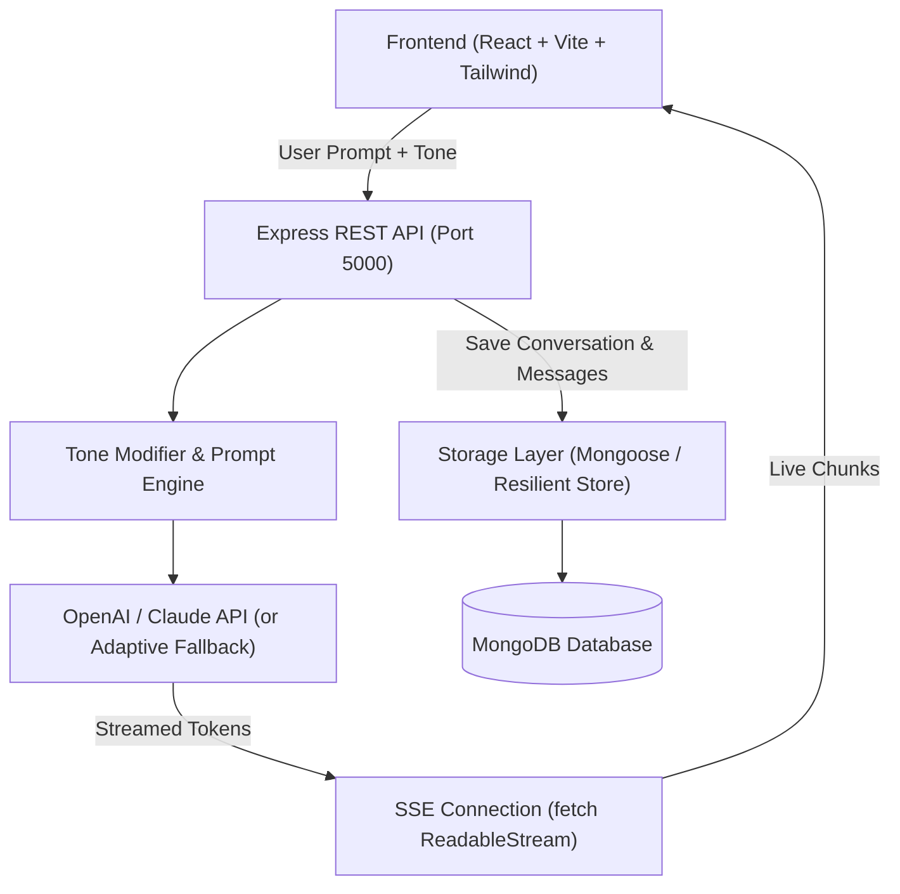

# 🤖 AI Chat Assistant (Real-Time Streaming & Multi-Tone)

> Built for the **Quantiphi Vibe Coding Round** — A production-grade, full-stack conversational AI platform featuring low-latency Server-Sent Events (SSE) streaming, dynamic tone modulation via backend system instructions, thread persistence, and developer-first UI enhancements.

---

## 🌟 Key Features

### 1. Frontend UI & User Interaction
- **Distinct Chat Bubbles:** High-contrast visual hierarchy differentiating user prompts (indigo gradient) and AI responses (slate cards with avatar and tone tags).
- **Real-Time Streaming View:** Token-by-token character streaming with blinking terminal cursor via Server-Sent Events (SSE).
- **History Sidebar:** Seamless navigation across past conversation threads with search filtering, creation of new chats, and thread deletion.
- **Responsive Layout:** Adaptive sidebar for desktop and mobile devices with collapsible navigation.

### 2. Backend Logic & State Management
- **LLM API Integration:** Seamless connectivity to OpenAI (`gpt-4o-mini`, `gpt-4o`) or Claude API endpoints, backed by an intelligent tone-adaptive fallback engine for zero-setup execution.
- **Decoupled Persistence (MongoDB & Resilient Fallback):** Production Mongoose models storing conversation ID, title, timestamps, user prompts, AI responses, and applied tones. If a local MongoDB instance is not detected, it automatically falls back to an atomic file-backed JSON store without crashing.
- **Server-Side Business Logic:** All tone instructions, prompt engineering, and validations are strictly enforced on the server.

### 3. "The Vibe Check" — Dynamic Tone Toggle
Users can toggle between three distinct personas instantly:
- 👔 **Professional:** Articulate, structured, executive-ready formatting, formal terminology, and strategic analysis.
- 💬 **Casual:** Friendly, energetic, conversational tone with analogies and emojis.
- ⚡ **Concise:** Razor-sharp density, direct bullet points, zero pleasantries or boilerplate.

The server injects these as distinct system prompt modifiers on every request, changing the style of the response in real time.

### 4. 🚀 Extra Features Included
1. **Interactive Code Highlighting & 1-Click Code Copy:** Markdown code blocks are automatically parsed with syntax badges and a one-click copy button providing instant visual feedback (`Copied!`).
2. **Conversation Export (Markdown & JSON):** One-click download of the complete chat transcript formatted as clean `.md` or raw `.json` including tone metadata and timestamps.
3. **Real-Time Search Filter in History Sidebar:** Instant text search across previous conversation titles and preview messages.
4. **Stream Cancellation ("Stop Generation") & Quick Starters:** Ability to abort streaming generation mid-stream using standard `AbortController` and quick starter prompt pills.

---

## 🏛️ Architecture Overview



---

## 📁 Project Structure

```
Ai-chat-assistant/
├── backend/
│   ├── src/
│   │   ├── config/
│   │   │   └── db.js               # MongoDB connection with resilient fallback
│   │   ├── models/
│   │   │   └── Conversation.js     # Mongoose conversation schema
│   │   ├── controllers/
│   │   │   └── chatController.js   # SSE streaming & CRUD controller
│   │   ├── services/
│   │   │   ├── aiService.js        # Tone system prompt injection & LLM stream
│   │   │   └── storageService.js   # Unified repository persistence layer
│   │   ├── routes/
│   │   │   └── chatRoutes.js       # Express API routes
│   │   └── index.js                # Server entrypoint
│   ├── test-api.js                 # Automated API & Streaming verification test suite
│   ├── .env.example                # Backend environment template
│   └── package.json
├── frontend/
│   ├── src/
│   │   ├── components/
│   │   │   ├── Header.jsx          # Header with tone toggle, DB indicator & export
│   │   │   ├── Sidebar.jsx         # Conversation history & search filter
│   │   │   ├── ChatWindow.jsx      # Scrollable conversation view & empty state
│   │   │   ├── ChatMessage.jsx     # Markdown renderer & 1-click code copy
│   │   │   ├── ChatInput.jsx       # Input box, suggestions & stop button
│   │   │   └── ToneToggle.jsx      # Tone selection switch
│   │   ├── services/
│   │   │   └── api.js              # SSE streaming reader and HTTP client
│   │   ├── App.jsx                 # Main state orchestration
│   │   ├── main.jsx
│   │   └── index.css
│   ├── package.json
│   ├── vite.config.js
│   └── tailwind.config.js
├── package.json                    # Root orchestration scripts
└── README.md
```

---

## 🚀 Getting Started

### Prerequisites
- Node.js (v18+ recommended)
- MongoDB (Optional: The application connects automatically if running, or uses local persistent storage fallback seamlessly)

### 1. Installation
Clone the repository and install all dependencies:
```bash
# Install root, backend, and frontend dependencies
npm run install:all
```
*(Or navigate to `backend/` and `frontend/` individually and run `npm install`)*

### 2. Environment Setup
Configure backend environment:
```bash
cd backend
cp .env.example .env
```

Edit `backend/.env`:
```env
PORT=5000
MONGODB_URI=mongodb://127.0.0.1:27017/ai_chat_assistant
OPENAI_API_KEY=your_openai_api_key_here # Optional: Built-in adaptive fallback works out of the box!
OPENAI_MODEL=gpt-4o-mini
DEFAULT_TONE=Professional
```

### 3. Run the Application
Run both backend and frontend concurrently with a single command from root:
```bash
npm run dev
```

- **Frontend:** http://localhost:5173
- **Backend API:** http://localhost:5000
- **Health Check:** http://localhost:5000/api/health

---

## 🧪 Automated Testing & Verification

Run the comprehensive end-to-end test suite:
```bash
cd backend
node test-api.js
```

The test suite validates:
1. Health check & database connection
2. Conversation creation
3. Real-time token streaming across all three tones: **Professional**, **Casual**, and **Concise**
4. Multi-turn conversation persistence
5. History listing and filtering
6. Thread deletion

---

## 💡 Viva & Evaluation Highlights

| Requirement | Implementation Detail |
|---|---|
| **Real-time SSE Streaming** | Implemented using standard Server-Sent Events (`text/event-stream`) in Express, consumed in React using `ReadableStream` & `TextDecoder` for zero third-party client dependency overhead. |
| **Tone Toggle** | Dynamically modifies `system` instruction at server level. Evaluated on the backend to enforce zero client-side tampering of prompt logic. |
| **Persistence** | MongoDB schema with nested message documents, timestamps, and tone history. Employs dual-layer persistence fallback for zero downtime. |
| **Production UX** | Syntax highlighted code blocks with copy-to-clipboard, export to Markdown/JSON, thread search, responsive sidebar, auto-scroll, and stop generation. |
